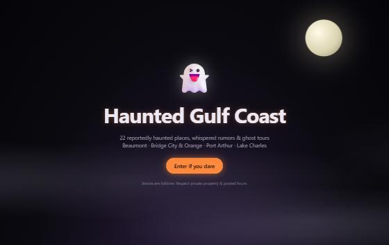
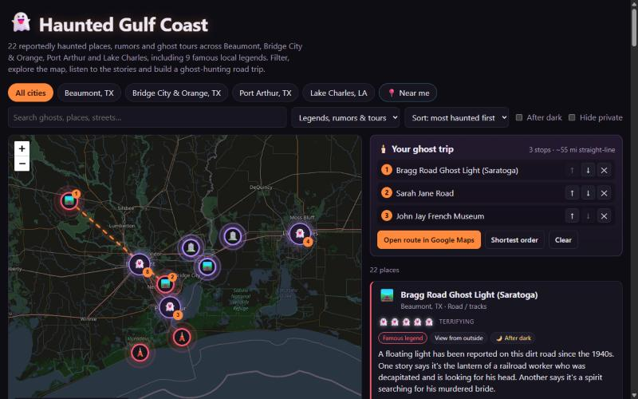
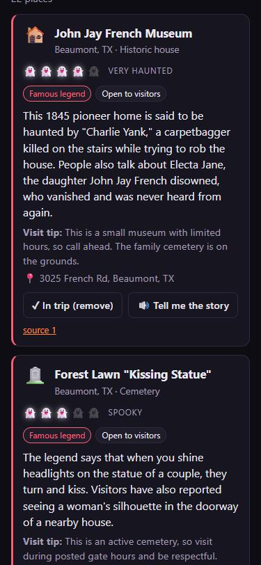

# 👻 Haunted Gulf Coast

**A ghost-trip planner for Southeast Texas and Southwest Louisiana.**
It maps 22 reportedly haunted places, local rumors and ghost tours across **Beaumont, Bridge City & Orange, Port Arthur and Lake Charles**. You can hear each legend read aloud and build a ghost-hunting road trip that opens in Google Maps.

**Live demo:** https://burritoman190.github.io/haunted-gulf-coast/







---

## ✨ Features

| Feature | What it does |
|---|---|
| 🌫️ **Spooky intro** | A full-screen fog-and-moon landing page with a flickering title and an "Enter if you dare" button. |
| 🗺️ **Interactive dark map** | Glowing, pulsing pins colored by story type. Nearby pins group into ghost clusters. |
| 👻 **Fright meter** | Every place gets 1–5 ghosts, from "Faint chill" to "Terrifying". You can sort by **most haunted first**. |
| 🔊 **Tell me the story** | Reads each legend aloud with the browser's built-in voice, so it works on a night drive. |
| 📍 **Near me** | Uses your location to show how far each haunt is and sorts the closest first. |
| 🕯️ **Trip planner** | Add stops, reorder them or click **Shortest order**. The route draws on the map and opens in Google Maps. It's saved in your browser. |
| 🔎 **Filters** | Filter by city, story type, "after dark" spots or hiding private property, or use full-text search. |
| 🛡️ **Responsible visiting** | Each place shows how you can visit it (open, events only, outside only, or private) plus a visit tip and source links. Private places can't be added to a trip. |
| 📱 **Mobile friendly** | The layout adapts to phones with no sideways scrolling. |

### Story types (pin colors)
- 🔴 **Famous legend:** a well-known, named ghost story, such as Toni Jo Henry at the Calcasieu Courthouse, Sarah Jane Road or the Bragg Road light.
- 🟣 **Local rumor:** witness reports, listings in ghost books, or local hearsay.
- 🟢 **Ghost tour / talk:** tours, exhibits and talks where the local stories are told.

---

## 🧰 What I used

**Code & frameworks**
- [React 18](https://react.dev/) for the UI components and state
- [Vite 5](https://vitejs.dev/) for the dev server and production build
- [Leaflet](https://leafletjs.com/) + [React Leaflet](https://react-leaflet.js.org/) for the interactive map
- [Leaflet.markercluster](https://github.com/Leaflet/Leaflet.markercluster) + [react-leaflet-cluster](https://github.com/akursat/react-leaflet-cluster) for the ghost clusters
- Plain CSS animations for the fog, flicker, pulsing pins and moving route (no UI library)

**Browser APIs (free, no API keys)**
- **Web Speech API** (`speechSynthesis`) for the "Tell me the story" narration
- **Geolocation API** for the "Near me" button
- **localStorage** to save your trip

**Data & services**
- [OpenStreetMap](https://www.openstreetmap.org/copyright) map tiles, styled dark with CSS
- Google Maps directions links for turn-by-turn routes (opened in a new tab)
- Location research from local tourism boards (Visit Beaumont CVB, Visit Lake Charles), local news (KPLC, Beaumont Enterprise, KOGT, American Press), museum sites, HauntedPlaces.org and Rita Cook's *Ghosts of Beaumont, Port Arthur and Beyond*. Each place links to its sources in the app.

**Tools**
- [Git](https://git-scm.com/) + [GitHub](https://github.com/) for version control
- [GitHub CLI](https://cli.github.com/) to create the repo
- [GitHub Actions](https://github.com/features/actions) + [GitHub Pages](https://pages.github.com/) to build and host the site on every push (`.github/workflows/deploy.yml`)
- [Claude Code](https://claude.com/claude-code) (Anthropic) as an AI pair programmer for research, coding and testing

---

## 🚀 Run it locally

```bash
npm install
npm run dev
```

Open http://localhost:5173.

## 🌐 Deploy

Every push to `main` builds the site and publishes it to GitHub Pages. To set it up once, go to **Settings → Pages → Source** and choose **GitHub Actions**.

## 📂 Project structure

```
src/
  data/locations.js      # all 22 places, fright ratings and sources
  components/
    Intro.jsx            # fog landing screen
    MapView.jsx          # Leaflet map, glowing pins, clusters, route line
    LocationCard.jsx     # story card with fright meter and narration
    TripPanel.jsx        # trip builder
    FrightMeter.jsx
  lib/
    trip.js              # distance, shortest-order and Google Maps links
    narrate.js           # text-to-speech helper
```

## ⚠️ About the data

- These are **reported ghost stories and rumors**, not verified fact.
- Coordinates are approximate, so check addresses before you drive.
- Respect private property, cemeteries and posted hours. Never walk on active railroad tracks.
- I found no rumors online for Bridge City itself, so that area uses nearby Orange County rumors (Wilkinson Cemetery, "Blood Road").

## 🔮 Roadmap

- "Submit a ghost story" form so locals can add rumors, starting with Bridge City
- Preset themed routes, such as "Lake Charles After Dark"
- Photos for every location
- Installable phone app (PWA) with offline mode
